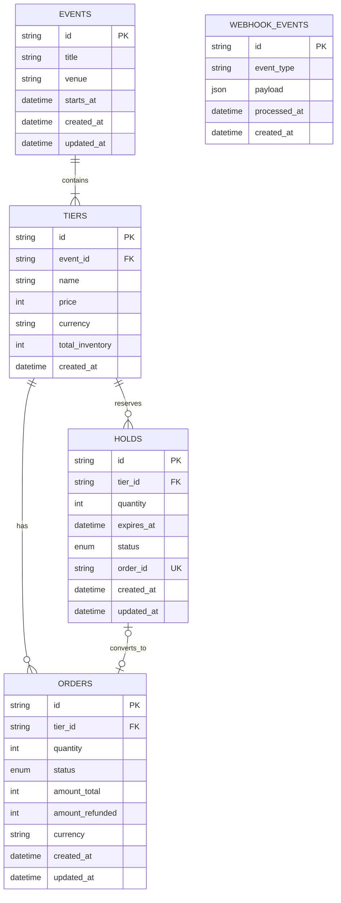

# Encore Tickets Inventory API

A concurrency-safe ticket inventory and reservation API built with Next.js, TypeScript, Prisma, and PostgreSQL. It supports event discovery, temporary ticket holds, order cancellation, and payment webhook processing with idempotency and refund handling.

## 1. Tech Stack

| Technology | Purpose | Why I chose it |
|---|---|---|
| **Next.js 14 (App Router)** | API routes and application framework | Provides a structured way to build REST endpoints within a single application. |
| **TypeScript** | Type safety | Helps catch errors early and makes service and API contracts easier to maintain. |
| **PostgreSQL (Neon)** | Relational database | Provides transactions, row-level locking, constraints, and reliable storage for inventory and order data. |
| **Prisma ORM 6** | Database access and schema management | Offers type-safe database queries, migrations, and a maintainable data model. |
| **Zod** | Request validation | Validates incoming API payloads and returns consistent validation errors. |
| **Vitest** | Automated testing | Tests inventory behavior, webhook idempotency, refunds, hold expiry, and concurrent reservations. |

### Key Design Decisions

- **PostgreSQL transactions and row-level locking:** Serialize inventory-changing operations for a given ticket tier to prevent overselling during concurrent requests.
- **Temporary holds:** Reserve inventory for 10 minutes, after which an expired hold releases its reserved capacity.
- **Webhook idempotency:** Store payment webhook event IDs and prevent duplicate events from being processed more than once.
- **Refund handling:** Track order refunds and release the corresponding ticket inventory according to the refund logic.
- **Database-backed inventory:** Calculate availability from total inventory, active unexpired holds, and tickets allocated to paid or partially refunded orders.

## 2. Database Schema

The database contains five main tables: `events`, `tiers`, `holds`, `orders`, and `webhook_events`.

### Entity Relationship Diagram



### Table Responsibilities

| Table | Responsibility |
|---|---|
| `events` | Stores event information, including title, venue, and start time. |
| `tiers` | Stores ticket categories, prices, currency, and total inventory for each event. |
| `holds` | Tracks temporary ticket reservations, their quantities, expiration times, and statuses. |
| `orders` | Stores payment order information, order status, total amount, and refund amount. |
| `webhook_events` | Records incoming payment webhook events to support idempotent processing and auditing. |

### Relationships

- One event can contain multiple ticket tiers.
- Each ticket tier belongs to one event.
- One ticket tier can have multiple holds and orders.
- A hold can be associated with an order through `holds.order_id`.
- Webhook events are tracked independently using their unique event IDs.

### Inventory Calculation

Available inventory is calculated as:

**Available = Total inventory − Active holds − Allocated orders**

Only active holds whose expiration time is in the future count as reserved inventory. Orders with `paid` or `partially_refunded` status count toward allocated inventory, subject to the refund handling implemented by the service.

## 3. API Endpoints

| Method | Endpoint | Description |
|---|---|---|
| `GET` | `/api/events/:event_id` | Retrieve event details, ticket tiers, and availability. |
| `POST` | `/api/events/:event_id/holds` | Create a temporary ticket hold. |
| `POST` | `/api/orders/:order_id/cancel-hold` | Cancel an associated active hold. |
| `POST` | `/api/webhooks/payments` | Process payment and refund webhook events. |

## 4. Core Business Rules

1. Holds expire after **10 minutes**.
2. Inventory-changing operations use database transactions and locking to prevent overselling.
3. Duplicate webhook event IDs must not cause duplicate processing.
4. Refund events received before payment events must not incorrectly turn a refunded order into a paid order.
5. Invalid requests, unavailable inventory, and invalid state transitions return appropriate API errors.

## 5. Running Locally

### Prerequisites

- Node.js
- A PostgreSQL database, such as Neon
- npm

### Setup

```bash
npm install
```

Create a `.env` file in the project root:

```env
DATABASE_URL="your_postgresql_connection_string"
```

Generate the Prisma client and apply migrations:

```bash
npx prisma generate
npx prisma migrate dev
```

Seed the database:

```bash
npx prisma db seed
```

Start the development server:

```bash
npm run dev
```

The API will be available at `http://localhost:3000`.

## 6. Testing

Run the automated tests using:

```bash
npm test
```

The integration tests cover:

- Duplicate payment webhook handling.
- Expired holds releasing inventory.
- Full refunds releasing inventory.
- Refund-before-payment ordering.
- Concurrent requests for the last available ticket.

Use a separate test database configured through `.env.test`. Do not run integration tests against production data.

## 7. Sample Seed Data

### Event 1: Anoushka Shankar — Live in Lisbon

| Ticket tier | Price | Inventory |
|---|---:|---:|
| Front Stalls | €8,500 | 50 |
| General Standing | €4,500 | 200 |
| Balcony | €3,000 | 100 |

### Event 2: Indie Devs Meetup — Berlin

| Ticket tier | Price | Inventory |
|---|---:|---:|
| Standard | €1,500 | 80 |
| Student | €800 | 20 |

**Note:** Prices are stored as integer values in the database. Confirm the intended monetary unit and formatting before presenting them as customer-facing prices.

## 8. Production Considerations

Before production deployment:

- Verify payment webhook signatures.
- Configure production environment variables securely.
- Apply database migrations through the deployment process.
- Add structured logging and monitoring.
- Test concurrent requests and refund scenarios against the production database engine.
- Deploy the API and document the live base URL.

